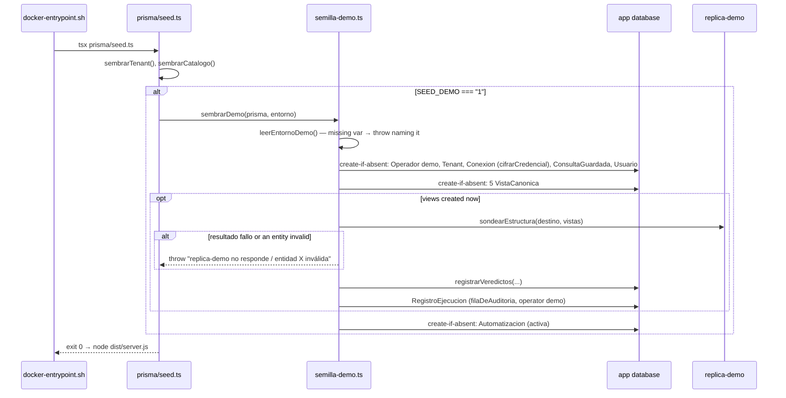

# Design: CH-31 — Development and test data

Inputs: proposal.md, the `project-environment` and `execution-audit` deltas, DEC-170, DEC-171, DEC-125, DEC-159/DEC-160, CH-07 (`cifrarCredencial`), CH-29 (`hashearClave`, `Operador`), CH-10 (the mapping probe).

## 1. Test database (`scripts/test-db.mjs`)

```
npm run test:db  →  node scripts/test-db.mjs
```

1. Resolve `TEST_DB_HOST` (`localhost`), `TEST_DB_PORT` (`5432`), `TEST_DB_USER` (`zerodashboard`), `TEST_DB_PASSWORD` (required: fail naming it), `TEST_DB_NAME` (`zerodashboard_test`). Refuse when the name is `zerodashboard` or equals `POSTGRES_DB`.
2. Connect to the `postgres` maintenance database with `pg`; `SELECT 1 FROM pg_database WHERE datname = $1`; when absent, `CREATE DATABASE` with the name quoted as an identifier (`pg`'s `escapeIdentifier`: a database name cannot be a driver parameter, rule 4 is about values).
3. `npx prisma migrate deploy` with `DATABASE_URL` built from the same values (`encodeURIComponent` on user and password).
4. `npx tsx --test "src/**/*.test.ts"` with `TEST_DB_NAME` set; exit with its code.

The helpers are untouched: they already read `TEST_DB_NAME`. `npm test` stays as is (unit tests run without a database; integration tests skip when it is unreachable).

## 2. `replica-demo`

```yaml
replica-demo:
  image: postgres:16-alpine
  profiles: ["demo"]
  environment:
    POSTGRES_USER: food_store_owner        # local to the container, never used by the app
    POSTGRES_PASSWORD: ${REPLICA_DEMO_PASSWORD:?…}
    POSTGRES_DB: food_store
    REPLICA_DEMO_PASSWORD: ${REPLICA_DEMO_PASSWORD:?…}
  volumes:
    - ./docker/replica-demo:/docker-entrypoint-initdb.d:ro
    - replica-demo-data:/var/lib/postgresql/data
  healthcheck: pg_isready -U food_store_owner -d food_store
app:
  depends_on:
    replica-demo: { condition: service_healthy, required: false }
```

- `docker/replica-demo/01-esquema-y-datos.sql`: `pg_dump --no-owner --no-privileges` of `food_store` (schema, data, the five `v_*` views). The `user` table rows are replaced by `demo1@example.com`… with the hash of a throwaway value. The dump is taken once by the owner, who holds the original's credentials.
- `docker/replica-demo/02-lector.sh`: `CREATE ROLE lector_zerodashboard LOGIN PASSWORD :'clave'` through `psql -v clave="$REPLICA_DEMO_PASSWORD"` (a psql variable, never interpolated by the shell), `GRANT CONNECT`, `GRANT USAGE ON SCHEMA public`, `GRANT SELECT ON ALL TABLES IN SCHEMA public`. Rule 3's second layer: no write grant.
- Inside the Compose network the app reaches it as `replica-demo:5432`. No host port is published.

## 3. Probe extraction (`src/validacion-mapeo-rutas.ts`)

The block that writes each verdict moves to an exported function in `src/validacion-mapeo.ts`:

```ts
export async function registrarVeredictos(
  vistaCanonica: { updateMany(args: …): Promise<unknown> },
  vistas: { id: string; entidad: string; sql: string; actualizadaEn: Date }[],   // contract order
  entidades: …,                                                                   // sondeo.entidades, its existing type
  validadaEn: Date,
): Promise<void>
```

Same stale-write guard (`where: { id, sql }`) and the same `actualizadaEn` preservation. The route calls it where the loop was. Everything else (ownership, `destinoDeConexion`, 409/404, audit, session failure, read-back) stays in the route. The structural type lets both the isolated client (route) and the plain client (seed) pass.

## 4. Demo seed (`src/semilla-demo.ts`)



- **Fixed ids** (UUID literals in an `IDS_DEMO` constant in `semilla-demo.ts`), so restarts are idempotent and do not depend on names.
- **Order:** with `SEED_DEMO=1`, `sembrarDemo()` runs **before** `sembrarTenant()`. Its fixed-id "Food Store" fills the table, so the generic tenant (created only on an empty table) is not added and there is one "Food Store", not two.
- **Create-if-absent:** `findUnique({ where: { id } })` then `create`; an existing row is never updated (DEC-125's rule). The probe runs only when at least one view was created in this run.
- **Environment:** `REPLICA_DEMO_PASSWORD`, `DEMO_OPERADOR_CLAVE` (checked with `validarClave`, ≥ 12), `DEMO_PANEL_CORREO` (checked with `correoValido`), `DEMO_PANEL_CLAVE`. `CREDENTIAL_MASTER_KEY` is already required by the app.
- **Connection row:** host `replica-demo`, port 5432, database `food_store`, user `lector_zerodashboard`, `motor` `postgres`, `soloLectura` true, direct (no agent).
- **Views:** for each contract entity `SELECT * FROM v_<entidad>`. The SQL is checked once during apply against the probe: if a column name or type does not match the contract, the view's SQL lists the columns with casts instead.
- **Saved query:** "Productos con poco stock". Saved queries run raw against the replica (no view composition), so it reads the real table: `name` and `stock_quantity` from `product` below a parameter `umbral` (`[{ nombre: 'umbral', tipo: 'numero' }]`), written in the placeholder syntax of CH-11, which apply checks against `src/parametros.ts`.
- **Automation:** template `stock-fisico`, `valores` `{ "umbral": 5 }`, `cron` `0 9 * * *`, `destinatario` `DEMO_PANEL_CORREO`, `activo` true. Mail reaches Mailpit only when `SMTP_HOST=mailpit` (profile `correo`); otherwise runs record `no-configurada`, as today.
- **Audit row:** `filaDeAuditoria({ origen: 'validacion-mapeo', conexionId, sql: probes joined by ";\n", consulta: null, plantillaId: null, operador: { id, nombre: 'demo' } }, veredictoDeSondeo(sondeo))` plus `tenantNombre`, written with the plain client.
- **Errors:** messages name the variable or the entity; the replica's driver error is reduced to `fase · categoria (codigo)`, never the password (the CH-10 precedent).

`prisma/seed.ts` imports `sembrarDemo` from `../dist/semilla-demo.js` like the catalog.

## 5. Tests

- `src/semilla-demo.test.ts`, against `TEST_DB_*` (skipped when unreachable), with the replica target being the test database itself through a fake `sondear` injected into `sembrarDemo` (the real probe is exercised by the route tests): missing variable → throws naming it; first run creates every row with fixed ids and one audit row; second run creates nothing and leaves an edited query as it was; a probe failure throws naming the cause and creates no automation.
- `validacion-mapeo-rutas.test.ts` passes unchanged (the extraction).
- `scripts/test-db.mjs`: the refusal to use `zerodashboard` is checked by running it with that name (manual, in verify).
- Manual: `docker compose down -v`, `docker compose --profile demo --profile correo up` with `SEED_DEMO=1`, and the console walk of the spec scenario.

## 6. Size forecast
PR1: `test:db`, `replica-demo`, the dump, `.env.example` (~170 hand-written + the dump). PR2: extraction, `semilla-demo.ts`, its tests, `seed.ts` (~350).
