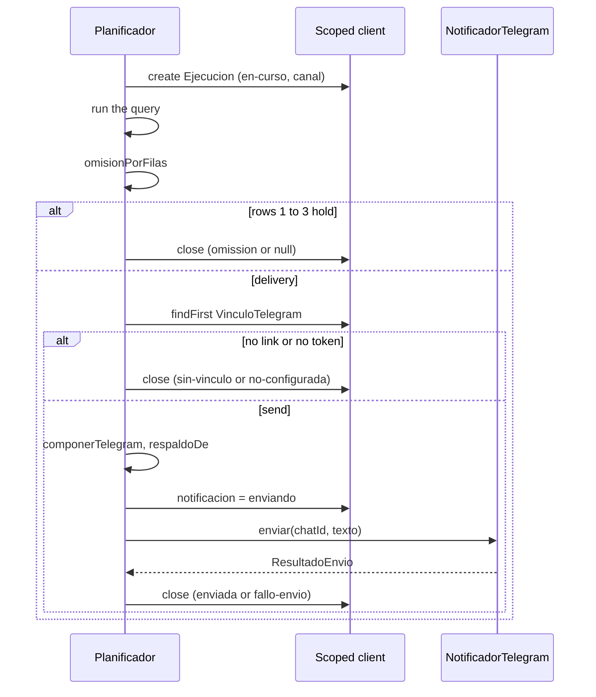

# Design: CH-44 — Telegram channel

Inputs: proposal.md, the eight delta specs, DEC-185, DEC-188, DEC-192, DEC-195, DEC-196, DEC-197. Story N4.

## 0. What the specs settle beyond DEC-197

None of these changes the model or a boundary, so none needs a new DEC. They are listed so the user can object.

- **The panel's offer is enforced on the server.** `canales` is the same rule for the read and the update, so a crafted `PUT` cannot choose Telegram with no link. The console stays free to set it: the operator configures ahead of the link.
- **An automation on Telegram can always go back.** `canales` holds `telegram` when it is the stored value, even with no link or token, so the form can still show it and switch to `correo`.
- **Going back to email needs an address.** It extends DEC-194's rule to the switch.
- **The notice does not check the token.** With a link and no token, runs record `no-configurada` and P2 sees no notice. That is an operator's fault, which the console shows, and P2 cannot fix it.
- **The link is read only when the result reaches the minimum.** A failed read cannot then turn a zero-row run into a failure.
- **Existing console texts stay for `correo`.** Only `telegram` adds or swaps texts, so the email suites keep passing unchanged.

## 1. Model and migration

`prisma/schema.prisma`, with the CH-44 comment:

```prisma
model Automatizacion {
  // ...
  canal String @default("correo")
}

model Ejecucion {
  // ...
  canal String?
}
```

New migration `20261106000000_canal_telegram`, additive:

```sql
-- CH-44: the automation's channel and the channel of each run (DEC-185, DEC-197). Additive.
-- Plain TEXT with its values in code, like `notificacion`. Existing automations read
-- 'correo'; existing runs read null, which means 'correo'. No chat id is stored.
-- Rollback (after reverting the code units):
--   ALTER TABLE "Ejecucion" DROP COLUMN "canal";
--   ALTER TABLE "Automatizacion" DROP COLUMN "canal";
ALTER TABLE "Automatizacion" ADD COLUMN "canal" TEXT NOT NULL DEFAULT 'correo';
ALTER TABLE "Ejecucion" ADD COLUMN "canal" TEXT;
```

`ADD COLUMN` with a constant default does not rewrite the table on PostgreSQL 11 or later, and a nullable one with no default never does, so the size of `Ejecucion` is not a concern.

## 2. Values and decision (`src/automatizaciones/automatizaciones.ts`)

```ts
export type Canal = 'correo' | 'telegram';
export function esCanal(valor: unknown): valor is Canal;

// EstadoNotificacion gains 'sin-vinculo', and OmisionNotificacion too.

/** Rows 1 to 3 of the precedence, shared by both channels. `undefined`: go on to delivery. */
export function omisionPorFilas(
  r: ResultadoCorrida,
  minimoFilas: number,
): { notificacion: OmisionNotificacion | null } | undefined;

export function decidirTelegram(
  r: ResultadoCorrida,
  chatId: bigint | null,
  configurado: boolean,
  minimoFilas: number,
): DecisionTelegram;
// { enviar: false; notificacion } | { enviar: true; chatId }
```

`decidirNotificacion` keeps its signature and calls `omisionPorFilas`, so its tests stay as they are. `cierreConNotificacion` does not change: it already treats any string as an omission.

**Decision: two thin functions over one condition.** A single function with a channel union would change every existing call and test. The shared part is the part that must not drift.

## 3. Client and notifier (`src/telegram/`)

`cliente-telegram.ts` gains one method, and `responder` stays as it is:

```ts
/** A notice: plain text, with link previews off. Same deadline and categories as `responder`. */
enviarAviso(chatId: bigint, texto: string): Promise<Resultado<void>>;
// sendMessage { chat_id: String(chatId), text, link_preview_options: { is_disabled: true } }
```

**Decision: a new method rather than an option on `responder`.** It keeps the fixed answers' request body byte for byte, which the spec pins.

New `notificador-telegram.ts`:

```ts
export interface NotificadorTelegram {
  enviar(chatId: bigint, texto: string): Promise<ResultadoEnvio>;
}
export function crearNotificadorTelegram(cliente: Pick<ClienteTelegram, 'enviarAviso'>): NotificadorTelegram;
```

It maps the categories of the `telegram-notification` table, and `codigo` is always `null`. The 10 s deadline of `TIEMPO_CORTO_MS` bounds the serial tick (DEC-110), as `smtpTimeoutMs` does for email.

## 4. Message (`src/automatizaciones/`)

`correo.ts` splits `textoDe` without changing its output, and exports what Telegram needs:

```ts
export interface PartesDeTexto { cabecera: string[]; cuerpo: string[]; avisos: string[]; pie: string }
export function partesDeTexto(e: EntradaCorreo): PartesDeTexto;
export function unirTexto(p: PartesDeTexto): string; // the current join
```

New `mensaje-telegram.ts`:

```ts
export const LIMITE_TELEGRAM = 4096;
export function componerTelegram(e: EntradaCorreo): string;
```

The steps:
1. `unirTexto(partes)`. If it fits, return it: this is the same bytes as the email's `texto`.
2. Otherwise build the notice with the real N and the frame (header, notices, notice, footer), then keep body lines in order while the running `.length` fits. Body line 0 is the column row or the template's header, and lines 1 onward are rows, so N is the kept lines minus one.
3. If not even line 1 fits whole, cut that line by code points (`Array.from`) to the room left, ending in `…`, and N is 1. The same applies to line 0 when it alone overflows.

The notice's digit count changes with N, so the frame is measured with M's digits, which is never shorter than N's. A result with no columns has an empty body and never overflows.

**Decision: `.length`, not code points.** It counts UTF-16 units, never fewer than the characters Telegram counts, so it can only err on the short side.

No escaping: without `parse_mode`, Telegram reads every character literally. `sustituir` already takes the channel's functions, and the text part passes identity.

## 5. The run (`src/automatizaciones/planificador.ts`)

`crearPlanificador` gains `notificadorTelegram?: NotificadorTelegram | null`. `AutomatizacionACorrer` (`:183`) and the due-automation `select` of the `findMany` at `:445` gain `canal`. Both `ejecucion.create` calls (`:357`, `:374`) write `canal`.

`notificar` branches at its first line, and the email path stays as it is:

```ts
async function notificarTelegram(a, plantilla, resultado, iniciadaEn, id) {
  const omision = omisionPorFilas(resultado, a.minimoFilas);
  if (omision !== undefined) return { salida: omision.notificacion, respaldo: null };
  let respaldo = null;
  try {
    const vinculo = await prisma.vinculoTelegram.findFirst({ select: { chatId: true } });
    const decision = decidirTelegram(resultado, vinculo?.chatId ?? null, notificadorTelegram !== null, a.minimoFilas);
    if (!decision.enviar) return { salida: decision.notificacion, respaldo: null };
    // compose, compute respaldo, write 'enviando', send: the same order as the email.
  } catch (error) {
    return { salida: { resultado: 'excepcion', error }, respaldo };
  }
}
```

A channel check is `a.canal === 'telegram'`, so a stored value outside the set runs as email.



The boot sweep already works on `enviando`, whatever the channel.

## 6. Wiring (`src/server.ts`, `src/app/rutas.ts`)

The client becomes one constant, handed to both users:

```ts
const clienteTelegram = configTelegram === null ? null : crearClienteTelegram(configTelegram.token);
const sondeo = clienteTelegram === null ? null : crearSondeoTelegram({ cliente: clienteTelegram, /* ... */ });
const notificadorTelegram = clienteTelegram === null ? null : crearNotificadorTelegram(clienteTelegram);
```

`registrarRutas` already takes `telegram: PuertoTelegram | null`, which is non-null exactly when the token is set, the same signal the run uses. `telegram !== null` feeds the preview and the panel adjust.

## 7. Console API (`src/automatizaciones/automatizaciones-rutas.ts`)

- `AutomatizacionCompleta` gains `canal`. The list projection does not.
- Both body schemas gain `canal: { type: 'string' }` and the key in `propertyNames` (`:107`, `:277`). `esCanal` validates it, so the answer names `/canal` like every other field.
- `resolverAjusteOperador` gains the check and `datos.canal`.
- `EjecucionListada` (`:58-70`) gains `canal`.

## 8. Preview (`src/automatizaciones/vista-previa.ts`)

- `respuestaDeVistaPrevia` keeps its parameters and adds `canal: 'correo'`, `telegram: null`.
- New `respuestaDeVistaPreviaTelegram(resultado, automatizacion, plantilla, chatId, configurado, fecha, zona)` uses `decidirTelegram`. It answers `para: []`, `correo: null` and `telegram: { texto }` for `enviar`, `sin-vinculo` and `no-configurada`.
- The route selects `canal`, and reads the link only for `telegram` and only after the query. The chat id stays inside the route.
- `OpcionesVistaPrevia` gains `telegramConfigurado`.
- `DECISIONES_CON_MENSAJE` semantics apply per channel. The audit write does not change.

## 9. Console UI (`src/consola/consola.ts`)

- New ids: `auto-canal`, `auto-canal-ayuda`, `aj-canal`, `aj-canal-ayuda`, added to the guarded list. Markup uses existing `zd-label` and `zd-input`.
- `aplicarCanalAlta()` and `aplicarCanalAjuste()` toggle `hidden` on the recipients label, field and help, on the schematic and on the channel help, and swap the minimum's help text.
- Create (`:2903`): `destinatarios` is sent only under `correo`, and `canal` only under `telegram`.
- Adjust: `baseAjuste` gains `canal`, and the change comparison and body (`:3016-3024`, `:3133`) include it. The stored channel fills it (`:3079`).
- Runs: `ETIQUETAS_NOTIFICACION` gains `sin-vinculo`. New `ETIQUETAS_NOTIFICACION_TELEGRAM` and `MENSAJES_TELEGRAM` are consulted first when `fila.canal === 'telegram'`, in `etiquetaNotificacion` and `errorDeCorrida` (`:3172-3189`).
- Preview: `mostrarVistaPrevia` (`:3287`) reads `cuerpo.canal`. Under `telegram` it fills the decision from `DECISIONES_VISTA_PREVIA_TELEGRAM`, sets `textoVistaPrevia.textContent`, and hides the subject and the frame.

## 10. Panel (`src/panel/`)

**List** (`panel-automatizaciones.ts`). The `findMany` selects `canal`, and `FilaAutomatizacion` gains it. One scoped `vinculoTelegram.findFirst({ select: { id: true } })` joins the `Promise.all`. `proyectarActiva` gains a `vinculado: boolean` parameter and writes `sinVinculo: true` only when it applies, as a named key.

**Adjust** (`panel-ajustes.ts`).
- New pure `canalesDe(canalGuardado, configurado, vinculado): Canal[]`, used by the read and the update.
- `proyectarAjustes` takes the list and writes `canal` and `canales`. No chat id is selected: the read is `{ select: { id: true } }`.
- `resolverAjustes` gets `canales`, checks a sent `canal` and applies the go-back rule against the sent or stored list. Both name fields in business terms, as today.
- The body schema gains `canal` (`:205`). `registerPanelAjustesRoutes` (`:253`) gains `telegramConfigurado`.

**UI** (`panel.ts`).
- `formularioDeAjustes` (`:497`) adds a `select` through `campoDeFormulario` when `canales.length > 1`, and toggles the `Enviar a` box on change.
- `cuerpoDeCambios` (`:443`) sends `destinatarios` only when the chosen channel is `correo`, and `canal` when it changed.
- `ERRORES_CAMPO` (`:359`) gains `canal`.
- `tarjetaActiva` (`:617`) adds the `zd-banner--warn` banner when `item.sinVinculo === true`, built with the existing `nodo` helpers.
- The subtitle «Lo que revisamos por vos y te mandamos por correo.» (`:281`) becomes «Lo que revisamos por vos y te avisamos.», since it is no longer always true.

Copy is checked against `glosario-panel.ts`: none of the terms it forbids appears.

## 11. Tests

Colocated (DEC-181). No test reaches `api.telegram.org`.

| File | Covers |
|------|--------|
| `automatizaciones.test.ts` | `omisionPorFilas`, `decidirTelegram`: every row, and the order of rows 4 and 5 |
| `mensaje-telegram.test.ts` (new) | Equal to `texto` when short, table form, literal markup, cut at a line, both notices, one long line, no unpaired surrogate, never above 4096 (a loop over sizes) |
| `correo.test.ts` | Existing assertions unchanged after the split |
| `notificador-telegram.test.ts` (new) | Each category mapping, `codigo` null |
| `cliente-telegram.test.ts` | `enviarAviso` body; `responder` body pinned; token never in errors |
| `planificador.test.ts` | Each outcome, `canal` on the rows, `omitida` too, two tenants, unlink and relink, failed link read, one call with no retry, correo reads no link, sweep |
| `vista-previa.test.ts` | Each decision, no chat id in the raw body, correo gains only `canal` and `telegram` |
| `automatizaciones-rutas.test.ts` | Default, accepted without a link, 400 on an unknown value, switching keeps recipients, runs listing |
| `consola.test.ts` | Select behavior, bodies, labels by the run's channel, failure texts, preview |
| `panel-automatizaciones.test.ts` | `sinVinculo` cases, allow-list, forbidden keys, two tenants |
| `panel-ajustes.test.ts`, `panel-ajustes-rutas.test.ts` | `canales`, each refusal, go-back rule, foreign id |
| `panel.test.ts` | Select, hidden field, banner, glossary |
| `aislamiento-panel.test.ts` | The list's link read stays scoped |

The migration runs in `npm run test:db`.

## 12. Docs

- `docs/guia/06-automatizaciones.md`: remove the limit at line 79, and add the channel, `sin-vinculo` and the limits (burst, group migration).
- `guidelines/pantallas.md` (P-02, P-04, P-07) and the console guide, in both copies of the skill.
- `docs/02-mapa-de-changes.md`: the CH-44 row.
- The ethical and legal note from DEC-185. Its place in `docs/` is settled during apply: `mapa-historias.md:246` names the chapter, and no section of the note exists yet.

## 13. Threat matrix

| Threat | Applies | Control | Test |
|--------|---------|---------|------|
| The token leaks through a URL, error or log | Yes | `urlMetodo` stays the only reader, and only categories leave | Fake failures carrying the token, on the send path |
| The chat id leaks through a response, row or log | Yes | Selected only inside the run and the preview route; the panel selects `id` | Raw-body checks and row inspection |
| A message reaches another tenant's chat | Yes | Scoped read inside the tenant context; no tenant or chat from a request | Two-tenant run tests |
| A crafted panel request sets a value outside the offer | Yes | `canales` enforced on `PUT`; strict schema | Route tests |
| Markup injection from a cell in Telegram | No | No `parse_mode` | Literal-text test |
| Markup injection in the console preview | Yes | `textContent` only; the frame stays empty | Scenario in `query-console` |
| A URL in a cell makes Telegram fetch it for a preview | Yes | `link_preview_options.is_disabled` | Body test |
| A slow Telegram blocks the serial tick | Yes | 10 s deadline in the client | Existing timeout test extended |
| Tenant SQL or stored values reach the message | No new path | The composer's input has no SQL or parameters (rule 5) | Inherited |

## 14. Rejected alternatives

- **A `Notificador` that hides the channel behind one `enviar`.** It would need a union of destinations and a shared message type, and email has a subject and HTML that Telegram lacks. The branch in `notificar` is clearer.
- **Reusing `sin-destinatario` for the missing link.** DEC-185 names `sin-vinculo`.
- **New `CategoriaEnvio` values for Telegram.** `Ejecucion.canal` already tells the console which text to show.
- **Reading the link with the automation at the start of the run.** An unlink during a retried query would be missed.
- **Refusing Telegram on the console without a link.** The operator often configures before the client links, and an unlink later reaches the same state anyway.

## 15. Size forecast

| Unit | Code | Tests |
|------|------|-------|
| Migration, values, decision | ~60 | ~80 |
| Client, notifier, message, split of `correo.ts` | ~110 | ~130 |
| Run and wiring | ~70 | ~120 |
| Console API and preview route | ~70 | ~90 |
| Console UI | ~90 | ~100 |
| Panel API and UI | ~110 | ~130 |
| Docs, guidelines, planning artifacts | ~90 | — |

**~1,050 changed lines**, without the planning artifacts themselves. The session chose Single PR, with a 400-line budget, so the tasks forecast must stop for the user. A clean split, if chosen, needs no compatibility code: **backend** (first three rows and the console API), then **console UI**, then **panel**.
